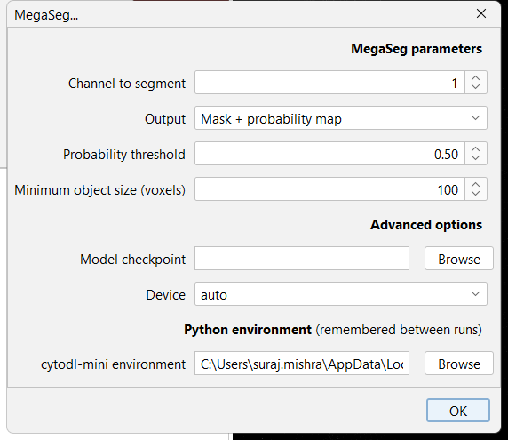

# SubCellSeg for Fiji

One-click [SubCellSeg](https://github.com/AllenCell/SubCellSeg) segmentation of 3D fluorescence
volumes from inside Fiji. Open an image, choose `Plugins › Segmentation › SubCellSeg...`, press OK.

SubCellSeg is a single generalist model: there is no structure to pick, no diameter to tune.
The plugin sends the selected channel to SubCellSeg, which runs in Python, and returns a binary mask
and/or an 8-bit probability map as new, calibrated images. Time-lapses are processed frame by frame.
The mask is the same one `subcellseg predict` gives on the command line.



## Install

1. **Add the plugin to Fiji.** Copy `SubCellSeg_Fiji-<version>.jar` into `Fiji.app/plugins/` and
   restart Fiji. (Once the update site exists: `Help › Update... › Manage Update Sites`, tick
   *SubCellSeg*, apply, restart.) The jar works in both classic (Java 8) and current (Java 21) Fiji.

2. **Install SubCellSeg** (once): `Plugins › Segmentation › SubCellSeg Setup...`, press OK.
   This installs [uv](https://docs.astral.sh/uv/) if needed, then SubCellSeg with the PyTorch build
   that matches your graphics card, and downloads the model (65 MB). It needs an internet connection
   and a few minutes; the first install downloads up to 3 GB. A message box shows the result,
   including whether a GPU was found.

   Prefer a terminal? Follow the
   [SubCellSeg installation instructions](https://github.com/AllenCell/SubCellSeg/blob/main/docs/INSTALL.md)
   instead; the plugin finds that installation by itself.

3. **Try it.** `Plugins › Segmentation › SubCellSeg Sample Image` opens a small test stack
   (nuclear speckles, SON-mEGFP, 40 slices). Then `Plugins › Segmentation › SubCellSeg...`, OK.

If SubCellSeg lives in a conda environment or venv of your own, tell the plugin where:
set **Python environment** in the dialog to that environment's folder, for example
`C:\Users\you\anaconda3\envs\subcellseg`. It is remembered. Setting the `SUBCELLSEG_PYTHON`
environment variable does the same.

Platforms: Windows and Linux with an NVIDIA GPU (seconds per stack) or CPU (minutes); macOS runs
on the CPU (Apple GPUs are not used yet).

## Use

`Plugins › Segmentation › SubCellSeg...`

| Parameter | Default | Meaning |
|---|---|---|
| **Channel to segment** | 1 | 1-based channel of the structure. Ignored for single-channel images. |
| **Output** | Mask | `Mask` (8-bit, 0/255), `Probability map` (8-bit, 0–255 ≙ 0–1), or both. |
| **Probability threshold** | 0.5 | Voxels with a probability above the threshold are foreground. 0.5 is the standard setting. |
| **Minimum object size (voxels)** | 0 | Remove 3D objects (voxels touching face to face) smaller than this. 0 keeps everything. |
| *Advanced* | | |
| **Model checkpoint** | empty | Empty = the pretrained SubCellSeg model. Choose a file to use a model you fine-tuned (`best.ckpt`). |
| **Device** | auto | `auto` uses the GPU if PyTorch sees one; `cpu` forces CPU. |
| *Environment* | | |
| **Python environment** | empty | Empty = found automatically (see Install). Otherwise a conda env / venv folder or a python executable. |

Results open as `<image>_SubCellSeg_mask` and/or `<image>_SubCellSeg_prob` with the input's
XYZ calibration and the same Z and T dimensions. Progress is shown in the status bar; details and
the exact Python command are in the Log window (`Window › Console` for the full Python output).

Notes

- SubCellSeg expects 3D stacks acquired near 100x / 0.108 µm xy, 0.29 µm z (the training resolution).
  Other magnifications work but quality drops with the mismatch; consider rescaling first.
- 2D images run but the model is 3D, so expect weaker results.
- RGB images are rejected; convert to a channel stack first.
- Time-lapses: every frame is segmented independently, with the model loaded once.

`Plugins › Segmentation › SubCellSeg Setup...` also updates SubCellSeg (*Install or update*),
repairs a broken installation (*Reinstall from scratch*) and reports what is installed
(*Check the installation*). *PyTorch build* can force a CPU-only or a specific CUDA build.

## Macro / batch

The command is recordable (`Plugins › Macros › Record...`). Parameter keys (case matters):

```
run("SubCellSeg...", "channel=1 output=Mask threshold=0.5 min_size=0 device=auto");
```

`output` is one of `Mask`, `[Probability map]`, `[Mask + probability map]`. Add
`python_env=[C:/path/to/env]` only if SubCellSeg is not found automatically. After the call the
mask is the active image (the probability map, if requested, is the one behind it), so `saveAs`
works as usual, also in headless mode.

Batch example:

```
dir = getDirectory("Choose a folder of TIFFs");
out = dir + "subcellseg/";
File.makeDirectory(out);
list = getFileList(dir);
for (i = 0; i < list.length; i++) {
    if (!endsWith(list[i], ".tif")) continue;
    open(dir + list[i]);
    run("SubCellSeg...", "channel=1 output=Mask threshold=0.5 min_size=50 device=auto");
    saveAs("Tiff", out + replace(list[i], ".tif", "_SubCellSeg_mask.tif"));
    close("*");
}
```

Scripts can call it directly and keep the outputs:

```groovy
#@ CommandService cmd
import org.allencell.subcellseg.fiji.SubCellSegCommand
def m = cmd.run(SubCellSegCommand.class, true, "imp", imp, "channel", 1, "output", "Mask + probability map").get()
def mask = m.getOutput("mask"); def prob = m.getOutput("probability")
```

## Build

No Maven needed; the scripts compile against the jars in your Fiji and use the JDK that ships
with Fiji (or `JAVA_HOME`):

```powershell
.\build.ps1 -Fiji C:\Fiji.app -Install       # Windows
```

```bash
./build.sh /Applications/Fiji.app --install  # macOS / Linux (also Git Bash on Windows)
```

`pom.xml` is a standard pom-scijava project for `mvn package` and for publishing to an update site.

## Tests

`test/run_tests.sh <Fiji.app>` builds, installs and runs the headless tests on macOS, Linux and
Windows (Git Bash), with the current or the classic Fiji launcher. It prints `passed:` / `failed:`
and exits non-zero on failure. Options: `--python-env DIR` (use that environment instead of the
automatically found one), `--setup [SOURCE]` (also exercise the Setup command; set `UV_TOOL_DIR`
to a scratch folder first to keep the test installation apart), `--install-dir DIR` (exercise the
*Install location* option; the preference is cleared again afterwards), `--skip-build`.

Individual tests (`fiji` = the Fiji launcher; add `--console` with the classic `ImageJ-*` launchers):

```
fiji --headless --run test/run_small_objects.groovy                              # size filter, no Python needed
fiji --headless --run test/run_sample.groovy "python_env='',expected='test/data/SubCellSeg_sample_SON_expected_mask.tif'"
fiji --headless --run test/run_setup.groovy "source='/path/to/SubCellSeg'"       # Setup command
fiji --headless --run test/run_headless.groovy "input='vol.tif',outdir='out',python_env='...'"
fiji --headless --run test/run_headless_ct.groovy "input='vol.tif',outdir='out',python_env='...'"   # channel + time-lapse
fiji --run test/run_gui_display.groovy "input='vol.tif',python_env='...'"                           # windows appear
```

`test/data/SubCellSeg_sample_SON_expected_mask.tif` is the GPU result on the bundled sample
(`SubCellSeg_sample_SON_gt.tif` is the hand-curated ground truth of the same crop). The sample is a
40 × 256 × 256 crop of `SON_136098` from the MegaSeg test set (Allen Cell Collection, hiPSC).

`.github/workflows/build.yml` runs the same script on Windows, Linux and macOS runners with a
CPU-only SubCellSeg; it needs the SubCellSeg repository and its weights release to be public.
`docs/MAC_TEST.md` is a step-by-step recipe for testing on a Mac.

## How it works

```
Fiji (Java)                                  Python (subcellseg)
 active image ─ pick channel ─ one TIFF/frame ─┐
                                               ├─ subcellseg_bridge.py: load the model once,
 new hyperstacks ◄─ <frame>_mask/_prob.tif ◄───┘  predict and threshold every frame
 remove small objects (in Java)
```

`src/main/resources/subcellseg_bridge.py` is bundled in the jar and extracted to a temp folder for each
run, so the Python environment only needs the `subcellseg` package itself.

The Python used is, in this order: the **Python environment** set in the dialog, the
`SUBCELLSEG_PYTHON` environment variable, the environment that `uv tool install` creates for
SubCellSeg (the *Install location* chosen in Setup, `UV_TOOL_DIR`, `%APPDATA%\uv\tools`,
`$XDG_DATA_HOME/uv/tools`, `~/.local/share/uv/tools`, `<Fiji>/subcellseg/tools`), and finally
`python` on the PATH.

The Setup command runs the official SubCellSeg install steps: the uv installer from `astral.sh`
if `uv` is not on the PATH or in `~/.local/bin`, then
`uv tool install --python 3.12 --torch-backend auto https://github.com/AllenCell/SubCellSeg/archive/refs/heads/main.zip`
(on macOS without the `--torch-backend` flag), `python -m subcellseg info`, and the model download.
*Install from* (advanced) accepts another archive URL or a local source folder. *Install location*
(advanced) moves everything uv creates (uv itself, Python, the environment, launchers, cache) into one
folder, for computers that refuse to run programs from the user profile; it is remembered in the
ImageJ preferences (`subcellseg.install_dir`).

## Publishing (maintainers)

1. Bump `<version>` in `pom.xml`; build; run `test/run_tests.sh`.
2. Push to GitHub; the workflow builds the jar on all three platforms.
3. Upload the jar to the *SubCellSeg* update site with the Fiji Updater (`Help › Update... › Manage
   Update Sites › Add Unlisted Site` with your sites.imagej.net credentials, then *Advanced mode*,
   mark the jar *Upload*). Users who enabled the site receive the new version on their next update.
4. Tag the release and attach the jar to it for people who install by hand.

## Troubleshooting

| Message | Fix |
|---|---|
| *Python was not found* / *SubCellSeg is not installed* | `Plugins › Segmentation › SubCellSeg Setup...`. If SubCellSeg is installed in a conda env or venv, set **Python environment** to that folder. |
| *model could not be downloaded* | Download `subcellseg_v1.pt` from the [releases page](https://github.com/AllenCell/SubCellSeg/releases/tag/weights-v1) and select it under **Model checkpoint**. |
| Setup fails with a download error | A firewall may block `astral.sh`, `github.com`, `pypi.org` or `download.pytorch.org`; ask IT, or install SubCellSeg from a terminal. |
| Setup fails with *This program is blocked by group policy* (os error 1260) | The computer does not allow programs to run from the user profile (`AppData`). Run Setup again with **Install location** set to a folder inside the Fiji folder, e.g. `C:\Fiji.app\subcellseg`; Fiji already runs from there, so it is allowed. |
| It is very slow | `SubCellSeg Setup...` with *Check the installation*: if the `gpu` line does not name your graphics card, update the NVIDIA driver and run Setup again with *Reinstall from scratch*. |
| *GPU ran out of memory* | Device = `cpu`, or crop the image. |
| Nothing segmented | Check the channel; try a lower threshold and view the probability map. |

On failure the temporary folder is kept and its path is shown in the error dialog.
